# Informe Técnico — Entrega 2: Interconexión de Sistemas Autónomos y Acceso a Servicios en Packet Tracer

**Asignatura:** Telemática  
**Plataforma de simulación:** Cisco Packet Tracer  
**Escenario:** grupo de k = 2 estudiantes => n = k + 1 = 3 sistemas autónomos (`AS1`, `AS2` y `AS99`)  
**Integrantes:** David Cuadros y Felipe Gomez

---

## 1. Resumen de la solución

Se implementa la interconexión de dos AS de clientes (`AS1` y `AS2`) con un AS proveedor de servicios (`AS99`), que aloja un servidor DNS y un servidor WEB. Las decisiones principales son:

1. **No se modifica el direccionamiento interno de los clientes:** `AS1` y `AS2` usan las mismas redes `10.0.0.0/24` y `172.16.0.0/24` (Restricción 5.a).
2. **Segmentación por VLAN y DHCP Relay:** en cada cliente, `VLAN 10` = `10.0.0.0/24`, `VLAN 20` = `172.16.0.0/24` y `VLAN 30` = red del servidor DHCP. Un servidor DHCP por AS entrega las direcciones a las dos VLAN de clientes a través de `ip helper-address` en `R1` y `R3`.
3. **Dos IGP distintos (Req. 2.a):** **OSPFv2** en `AS1` (proceso 1) y en `AS99` (proceso 99), y **RIPv2** en `AS2`.
4. **Superposición de direcciones resuelta con NAT/PAT + eBGP:** los routers de borde (`AS1-R4` y `AS2-R2`) traducen todas sus redes internas a un bloque público exclusivo por cliente (`198.51.100.0/29` para `AS1`, `198.51.100.8/29` para `AS2`) y **solo esos bloques** se anuncian por eBGP al `AS99`.
5. **Limitación de iBGP en Packet Tracer:** solo `AS99-R6` habla BGP dentro del `AS99`. `R6` anuncia el agregado `203.0.113.0/24` a los clientes e inyecta en OSPF 99 una **ruta por defecto** hacia sí mismo, de modo que `R5` y `R7` le entregan el tráfico de retorno y `R6` decide el AS de destino con su tabla BGP.

---

## 2. Topología y hardware (Requerimiento 1)

### 2.1 Diagrama lógico

```
          AS1 (OSPF 1)                                     AS2 (RIPv2)
  [PC1]          [PC2]  [DHCP .100]              [PC1]          [PC2]  [DHCP .100]
    | V10          | V20   | V30                   | V10          | V20   | V30
  [SW1]           [   SW2   ]                     [SW1]           [   SW2   ]
    |                 | troncal 802.1Q              |                 | troncal 802.1Q
  [R1]--------------[R3]                          [R1]--------------[R3]
    | 192.168.1.4/30   | 192.168.1.8/30             | 192.168.2.4/30   | 192.168.2.8/30
  [R2]--------------[R4]  <- borde AS1            [R2]--------------[R4]
       192.168.1.12/30 |                    borde AS2 -> | 192.168.2.12/30
                       | Se0/0/0                 Se0/0/0 |
         200.1.99.0/30 \  eBGP                  eBGP   / 200.2.99.0/30
                        \                             /
                  Se0/0/0 \                         / Se0/0/1
                            [        AS99-R6        ]
                     Gi0/0 /                         \ Gi0/1
               203.0.113.0/30                       203.0.113.4/30
                         /                             \
                   [AS99-R5]-----------------------[AS99-R7]
                       |        203.0.113.8/30          |
              203.0.113.64/26                   203.0.113.128/26
                   [DNS .66]                      [WEB .130]
                                AS99 (OSPF 99)
```

Topología real armada en Packet Tracer 9.0.1 (archivo `Entrega_2_Telematica.pkt`; todos los enlaces en verde):

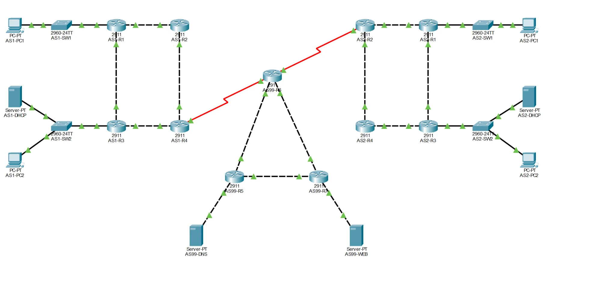

### 2.2 Decisiones de hardware

- **Routers:** Cisco 2911 en todos los casos. El 2911 tiene solo tres puertos (`Gi0/0`, `Gi0/1`, `Gi0/2`).
- **`AS99-R6` tiene 4 vecinos** (AS1, AS2, R5, R7). Se agrega el módulo **HWIC-2T** y los dos enlaces entre AS se hacen por **serial** (`Se0/0/0` y `Se0/0/1`), que es además lo típico de un enlace WAN cliente–proveedor. Por la misma razón `AS1-R4` y `AS2-R2` llevan HWIC-2T. `R6` es el extremo DCE (configura `clock rate`).
- **`R3` de cada cliente tiene 4 vecinos** (PC de la red 172.16.0.0/24, servidor DHCP, R1 y R4). En lugar de añadir un puerto, se agrega el switch **`SW2`** con dos VLAN (20 para clientes y 30 para el servidor DHCP) y `R3` enruta entre ellas con **Router-on-a-Stick** (subinterfaces `Gi0/0.20` y `Gi0/0.30` sobre un troncal 802.1Q). Así se aplica la segmentación por VLAN (Req. 1.c) en ambos lados del AS. Es la única diferencia con la Figura 1: el PC de `172.16.0.0/24` y el servidor DHCP siguen colgando de `R3`, pero a través de un switch.

### 2.3 Tabla de enlaces

| Origen | Destino | Cable | Red | Uso |
| :--- | :--- | :--- | :--- | :--- |
| `ASx-PC1` Fa0 | `ASx-SW1` Fa0/1 | Directo | `10.0.0.0/24` (VLAN 10) | Host red 10 |
| `ASx-SW1` Fa0/2 | `ASx-R1` Gi0/0 | Directo | `10.0.0.0/24` (VLAN 10) | Gateway + DHCP Relay |
| `ASx-PC2` Fa0 | `ASx-SW2` Fa0/1 | Directo | `172.16.0.0/24` (VLAN 20) | Host red 172 |
| `ASx-DHCP` Fa0 | `ASx-SW2` Fa0/2 | Directo | `192.168.x.96/29` (VLAN 30) | Servidor DHCP |
| `ASx-SW2` Gi0/1 | `ASx-R3` Gi0/0 | Directo | Troncal 802.1Q (20,30) | Router-on-a-Stick |
| `ASx-R1` Gi0/1 | `ASx-R3` Gi0/1 | Cruzado | `192.168.x.0/30` | IGP |
| `ASx-R1` Gi0/2 | `ASx-R2` Gi0/2 | Cruzado | `192.168.x.4/30` | IGP |
| `ASx-R3` Gi0/2 | `ASx-R4` Gi0/2 | Cruzado | `192.168.x.8/30` | IGP |
| `ASx-R2` Gi0/1 | `ASx-R4` Gi0/1 | Cruzado | `192.168.x.12/30` | IGP |
| **`AS1-R4` Se0/0/0** | **`AS99-R6` Se0/0/0** | Serial (DCE en R6) | **`200.1.99.0/30`** | **eBGP AS1–AS99** |
| **`AS2-R2` Se0/0/0** | **`AS99-R6` Se0/0/1** | Serial (DCE en R6) | **`200.2.99.0/30`** | **eBGP AS2–AS99** |
| `AS99-R6` Gi0/0 | `AS99-R5` Gi0/1 | Cruzado | `203.0.113.0/30` | OSPF 99 |
| `AS99-R6` Gi0/1 | `AS99-R7` Gi0/1 | Cruzado | `203.0.113.4/30` | OSPF 99 |
| `AS99-R5` Gi0/2 | `AS99-R7` Gi0/2 | Cruzado | `203.0.113.8/30` | OSPF 99 |
| `AS99-R5` Gi0/0 | `AS99-DNS` Fa0 | Cruzado | `203.0.113.64/26` | Red DNS |
| `AS99-R7` Gi0/0 | `AS99-WEB` Fa0 | Cruzado | `203.0.113.128/26` | Red WEB |

`ASx` = `AS1` y `AS2`; `x` = 1 en AS1 y 2 en AS2.

---

## 3. Plan de direccionamiento (Requerimiento 1.d)

**Criterio:** las redes de clientes `10.0.0.0/24` y `172.16.0.0/24` son fijas (enunciado). Para lo que no está definido:

- Infraestructura interna de cada cliente: `192.168.x.0/24` con x = número del AS (enlaces `/30`, red del DHCP `/29`, loopbacks `/32` desde `.201`). Se repite el patrón en ambos AS sin conflicto, porque estas redes nunca salen del AS (se traducen con NAT).
- Bloques públicos de los clientes: `198.51.100.0/29` (AS1) y `198.51.100.8/29` (AS2), del rango de documentación RFC 5737.
- Enlaces entre AS: `200.<AS cliente>.99.0/30`.
- AS99: `203.0.113.0/24` (RFC 5737), dividido en `/30` para enlaces y `/26` para cada servidor.

### 3.1 AS1 (OSPF 1)

| Dispositivo | Interfaz | IPv4 | Máscara | Observaciones |
| :--- | :--- | :--- | :--- | :--- |
| `AS1-PC1` | Fa0 | DHCP (`10.0.0.x`) | /24 | GW `10.0.0.1`, DNS `203.0.113.66` |
| `AS1-PC2` | Fa0 | DHCP (`172.16.0.x`) | /24 | GW `172.16.0.1`, DNS `203.0.113.66` |
| `AS1-DHCP` | Fa0 | `192.168.1.100` | /29 | GW `192.168.1.97` |
| `AS1-R1` | Gi0/0 | `10.0.0.1` | /24 | VLAN 10, `ip helper-address 192.168.1.100` |
| `AS1-R1` | Gi0/1 | `192.168.1.1` | /30 | hacia R3 |
| `AS1-R1` | Gi0/2 | `192.168.1.5` | /30 | hacia R2 |
| `AS1-R1` | Lo0 | `192.168.1.201` | /32 | RID 1.1.1.1 |
| `AS1-R2` | Gi0/1 | `192.168.1.13` | /30 | hacia R4 |
| `AS1-R2` | Gi0/2 | `192.168.1.6` | /30 | hacia R1 |
| `AS1-R2` | Lo0 | `192.168.1.202` | /32 | RID 1.1.1.2 |
| `AS1-R3` | Gi0/0.20 | `172.16.0.1` | /24 | VLAN 20, `ip helper-address 192.168.1.100` |
| `AS1-R3` | Gi0/0.30 | `192.168.1.97` | /29 | VLAN 30, red del DHCP |
| `AS1-R3` | Gi0/1 | `192.168.1.2` | /30 | hacia R1 |
| `AS1-R3` | Gi0/2 | `192.168.1.9` | /30 | hacia R4 |
| `AS1-R3` | Lo0 | `192.168.1.203` | /32 | RID 1.1.1.3 |
| `AS1-R4` | Se0/0/0 | `200.1.99.1` | /30 | `ip nat outside`, eBGP con AS99 |
| `AS1-R4` | Gi0/1 | `192.168.1.14` | /30 | `ip nat inside`, hacia R2 |
| `AS1-R4` | Gi0/2 | `192.168.1.10` | /30 | `ip nat inside`, hacia R3 |
| `AS1-R4` | Lo0 | `192.168.1.204` | /32 | RID 1.1.1.4 |
| `AS1-R4` | Lo1 | `198.51.100.1` | /29 | Bloque público AS1 (pool NAT `.2`–`.6`) |

### 3.2 AS2 (RIPv2)

| Dispositivo | Interfaz | IPv4 | Máscara | Observaciones |
| :--- | :--- | :--- | :--- | :--- |
| `AS2-PC1` | Fa0 | DHCP (`10.0.0.x`) | /24 | GW `10.0.0.1`, DNS `203.0.113.66` |
| `AS2-PC2` | Fa0 | DHCP (`172.16.0.x`) | /24 | GW `172.16.0.1`, DNS `203.0.113.66` |
| `AS2-DHCP` | Fa0 | `192.168.2.100` | /29 | GW `192.168.2.97` |
| `AS2-R1` | Gi0/0 | `10.0.0.1` | /24 | VLAN 10, `ip helper-address 192.168.2.100` |
| `AS2-R1` | Gi0/1 | `192.168.2.1` | /30 | hacia R3 |
| `AS2-R1` | Gi0/2 | `192.168.2.5` | /30 | hacia R2 |
| `AS2-R1` | Lo0 | `192.168.2.201` | /32 | |
| `AS2-R2` | Se0/0/0 | `200.2.99.1` | /30 | `ip nat outside`, eBGP con AS99 |
| `AS2-R2` | Gi0/1 | `192.168.2.13` | /30 | `ip nat inside`, hacia R4 |
| `AS2-R2` | Gi0/2 | `192.168.2.6` | /30 | `ip nat inside`, hacia R1 |
| `AS2-R2` | Lo0 | `192.168.2.202` | /32 | BGP RID 2.2.2.2 |
| `AS2-R2` | Lo1 | `198.51.100.9` | /29 | Bloque público AS2 (pool NAT `.10`–`.14`) |
| `AS2-R3` | Gi0/0.20 | `172.16.0.1` | /24 | VLAN 20, `ip helper-address 192.168.2.100` |
| `AS2-R3` | Gi0/0.30 | `192.168.2.97` | /29 | VLAN 30, red del DHCP |
| `AS2-R3` | Gi0/1 | `192.168.2.2` | /30 | hacia R1 |
| `AS2-R3` | Gi0/2 | `192.168.2.9` | /30 | hacia R4 |
| `AS2-R3` | Lo0 | `192.168.2.203` | /32 | |
| `AS2-R4` | Gi0/1 | `192.168.2.14` | /30 | hacia R2 |
| `AS2-R4` | Gi0/2 | `192.168.2.10` | /30 | hacia R3 |
| `AS2-R4` | Lo0 | `192.168.2.204` | /32 | |

### 3.3 AS99 (OSPF 99 + eBGP)

| Dispositivo | Interfaz | IPv4 | Máscara | Observaciones |
| :--- | :--- | :--- | :--- | :--- |
| `AS99-R6` | Se0/0/0 | `200.1.99.2` | /30 | DCE, eBGP con AS1 |
| `AS99-R6` | Se0/0/1 | `200.2.99.2` | /30 | DCE, eBGP con AS2 |
| `AS99-R6` | Gi0/0 | `203.0.113.1` | /30 | hacia R5 |
| `AS99-R6` | Gi0/1 | `203.0.113.5` | /30 | hacia R7 |
| `AS99-R6` | Lo0 | `203.0.113.206` | /32 | RID 99.99.99.6 |
| `AS99-R5` | Gi0/0 | `203.0.113.65` | /26 | Gateway del DNS |
| `AS99-R5` | Gi0/1 | `203.0.113.2` | /30 | hacia R6 |
| `AS99-R5` | Gi0/2 | `203.0.113.9` | /30 | hacia R7 |
| `AS99-R5` | Lo0 | `203.0.113.205` | /32 | RID 99.99.99.5 |
| `AS99-R7` | Gi0/0 | `203.0.113.129` | /26 | Gateway del WEB |
| `AS99-R7` | Gi0/1 | `203.0.113.6` | /30 | hacia R6 |
| `AS99-R7` | Gi0/2 | `203.0.113.10` | /30 | hacia R5 |
| `AS99-R7` | Lo0 | `203.0.113.207` | /32 | RID 99.99.99.7 |
| `AS99-DNS` | Fa0 | `203.0.113.66` | /26 | GW `203.0.113.65` |
| `AS99-WEB` | Fa0 | `203.0.113.130` | /26 | GW `203.0.113.129`, `www.as99.com` |

---

## 4. Decisiones de ingeniería y justificación

### 4.1 VLAN y DHCP Relay (Req. 1.c y 4.a.iii)

- `SW1` pone a los hosts de `10.0.0.0/24` en la **VLAN 10**; el puerto hacia `R1` es de acceso en esa VLAN.
- `SW2` pone a los hosts de `172.16.0.0/24` en la **VLAN 20** y al servidor DHCP en la **VLAN 30**. El puerto hacia `R3` es un **troncal 802.1Q** que transporta ambas VLAN; `R3` tiene una subinterfaz por VLAN (`encapsulation dot1Q 20` / `30`). Clientes y servidor quedan en dominios de broadcast separados y el tráfico entre ellos pasa por el router.
- Como el `DHCPDISCOVER` es un broadcast que un router no reenvía, en `R1 Gi0/0` y `R3 Gi0/0.20` se configura `ip helper-address <IP del DHCP>`. El router reenvía la solicitud por unicast al servidor y coloca en el campo `giaddr` la IP de la interfaz que la recibió (`10.0.0.1` o `172.16.0.1`). El servidor elige el pool cuya red coincide con `giaddr`. Por eso el servidor DHCP de cada AS tiene un pool para `10.0.0.0/24` y otro para `172.16.0.0/24`.
- Cada AS tiene **su propio** servidor DHCP: aunque los pools de AS1 y AS2 son idénticos, no hay conflicto porque cada servidor solo atiende solicitudes de su propio AS.

### 4.2 IGP (Req. 2)

- **AS1 – OSPFv2, proceso 1, área 0.** Las interfaces hacia hosts y servidores son `passive-interface` (no envían Hellos a la LAN). `AS1-R4` propaga la salida al AS99 con `default-information originate`, a partir de su ruta estática por defecto.
- **AS2 – RIPv2** con `no auto-summary` (hay máscaras /24, /29, /30 y /32 que no deben resumirse por clase). `AS2-R2` propaga la ruta por defecto con `default-information originate`.
- **AS99 – OSPFv2, proceso 99, área 0** en el triángulo R5–R6–R7.

Con esto se cumple que no haya un único IGP en toda la topología.

### 4.3 Superposición de direcciones (Consideraciones y Restricción 5)

**Problema.** Si `AS1` y `AS2` anunciaran `10.0.0.0/24` y `172.16.0.0/24` a `AS99`, `R6` recibiría el mismo prefijo desde dos AS, instalaría solo un mejor camino y las respuestas de DNS/WEB para el otro cliente se enviarían al AS equivocado.

**Solución: PAT en el borde + un prefijo público único por cliente anunciado por eBGP.**

| Cliente | Router de borde | Bloque público | Pool PAT | Anunciado por eBGP |
| :--- | :--- | :--- | :--- | :--- |
| AS1 | `AS1-R4` | `198.51.100.0/29` (Lo1 = `.1`) | `.2` – `.6` | `198.51.100.0/29` |
| AS2 | `AS2-R2` | `198.51.100.8/29` (Lo1 = `.9`) | `.10` – `.14` | `198.51.100.8/29` |

Ejemplo: `AS1-PC1` (`10.0.0.10`) y `AS2-PC1` (`10.0.0.10`) consultan el DNS al mismo tiempo. `AS99` ve como origen `198.51.100.2` y `198.51.100.10`, que son distintos y apuntan cada uno a su AS en la tabla BGP de `R6`. Las IP internas no cambian (Restricción 5.a) y la conectividad con `AS99` es extremo a extremo (Restricción 5.b).

La interfaz `Loopback1` hace que el bloque `/29` esté en la tabla de rutas del router de borde, requisito para que el comando `network ... mask ...` de BGP lo anuncie.

### 4.4 ¿Hay conectividad entre los AS de clientes? (Req. 3.a)

- **Entre las IP privadas internas: no.** Si `AS1-PC1` intenta llegar a `10.0.0.x` de `AS2`, su propia máscara le dice que ese destino está en su LAN y lo busca por ARP sin pasar por el gateway. Si intenta llegar a `172.16.0.x`, `AS1-R1` tiene esa red en su tabla OSPF (está dentro de `AS1`) y la ruta específica le gana a la ruta por defecto, así que el paquete nunca sale del AS. Además, `AS99` no conoce ninguna red privada de los clientes.
- **Entre los bloques públicos: sí, de forma limitada.** `R6` reenvía por eBGP el prefijo de cada cliente al otro. Un host de `AS1` puede hacer ping a `198.51.100.9` (Loopback1 de `AS2-R2`) y viceversa. Lo que no se puede es iniciar una conexión hacia un host interno del otro cliente, porque el PAT dinámico solo crea traducciones para el tráfico que sale. Para permitirlo haría falta NAT estático o reenvío de puertos en el borde destino (por ejemplo, `198.51.100.11` → `10.0.0.11` en `AS2-R2`).

### 4.5 Limitaciones de iBGP en Packet Tracer (Req. 3.b y 3.c)

En un ISP real, `R5`, `R6` y `R7` formarían una malla iBGP (o usarían un route reflector) con `next-hop-self` en `R6`, y aprenderían así los prefijos de los clientes. Packet Tracer no permite montar esa solución: no ofrece una implementación completa de iBGP ni `next-hop-self`.

**Solución funcional aplicada:**

1. `R6` es el único router de `AS99` con BGP. Tiene las sesiones eBGP con `AS1` (`200.1.99.1`) y `AS2` (`200.2.99.1`).
2. `R6` anuncia el agregado `203.0.113.0/24`, anclado a la ruta estática `ip route 203.0.113.0 255.255.255.0 Null0` (BGP solo anuncia prefijos que están en la tabla de rutas). Las subredes más específicas del DNS (`/26`) y del WEB (`/26`) se aprenden por OSPF; por coincidencia del prefijo más largo, el tráfico va al servidor y `Null0` solo descarta destinos no asignados.
3. Para el tráfico de retorno, `R6` inyecta en OSPF 99 una **ruta por defecto** (`ip route 0.0.0.0 0.0.0.0 Null0` + `default-information originate`). En las pruebas se comprobó que el IOS de Packet Tracer **rechaza** la palabra `always` (`% Invalid input detected`) y que, sin ella, OSPF solo anuncia el `0.0.0.0/0` si `R6` tiene una ruta por defecto en su tabla; por eso se agregó la ruta estática a `Null0`. Sin ese cambio, `R5` y `R7` quedaban con *Gateway of last resort is not set* y los ping de los PC al DNS fallaban. La ruta a `Null0` no afecta a los clientes, porque las rutas BGP `198.51.100.0/29` y `198.51.100.8/29` son más específicas. `R5` y `R7` envían a `R6` cualquier destino fuera de `AS99`, y `R6` sabe por BGP si `198.51.100.0/29` está en `AS1` o si `198.51.100.8/29` está en `AS2`. Así, la información de los clientes vive solo en BGP y no hace falta redistribuir BGP en OSPF ni configurar rutas estáticas hacia los clientes.

La solución no es idéntica a un ISP real (Req. 3.c), pero es funcional y escala: un tercer cliente solo requiere una sesión eBGP más en `R6`.

---

## 5. Pruebas de funcionamiento (Requerimiento 6)

> Todas las capturas son **reales**, tomadas en Cisco Packet Tracer 9.0.1 sobre `Entrega_2_Telematica.pkt`. Todas las pruebas de esta sección pasaron después de una corrección en `AS99-R6` (ver 5.4 y 4.5).

### 5.1 DHCP (Req. 4.a.iii)
- En los 4 PC: *Desktop → IP Configuration → DHCP* (los 4 mostraron *DHCP request successful*). Luego, en *Command Prompt*, `ipconfig /all`.
- Resultado: `AS1-PC1` y `AS2-PC1` reciben `10.0.0.10/24` con GW `10.0.0.1`; `AS1-PC2` y `AS2-PC2` reciben `172.16.0.10/24` con GW `172.16.0.1`; DNS `203.0.113.66` en todos. El servidor DHCP que responde es `192.168.1.100` en AS1 y `192.168.2.100` en AS2, es decir, el relay (`ip helper-address`) de `R1` y `R3` funciona. Los dos PC1 quedan con la **misma IP** `10.0.0.10`, lo que se aprovecha en la prueba 5.6.

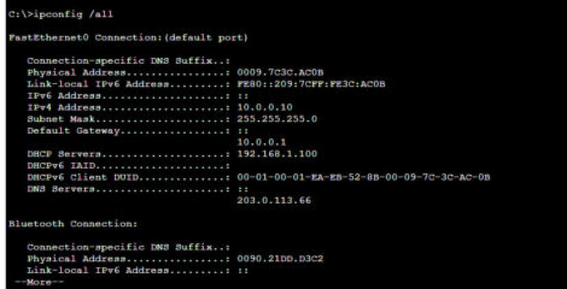

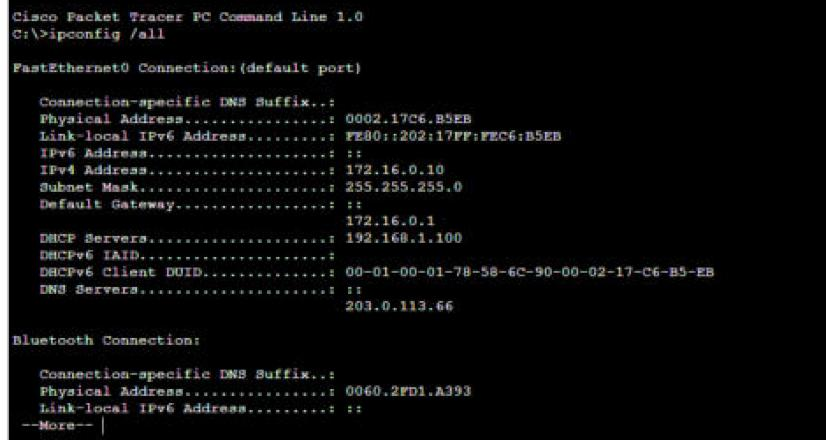

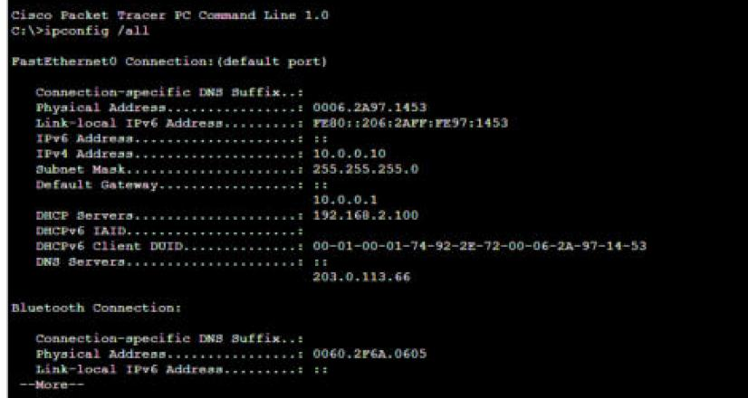

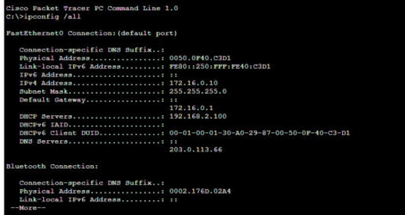

### 5.2 VLAN y troncal
- `show vlan brief` en `AS1-SW1`: Fa0/1–Fa0/24 en VLAN 10 (las VLAN 20 y 30 existen sin puertos).
- `show vlan brief` y `show interfaces trunk` en `AS1-SW2` y `AS2-SW2`: Fa0/1 y Fa0/3–24 en VLAN 20, Fa0/2 en VLAN 30, y Gi0/1 troncal 802.1Q (*trunking*) con VLAN permitidas y activas `20,30`.

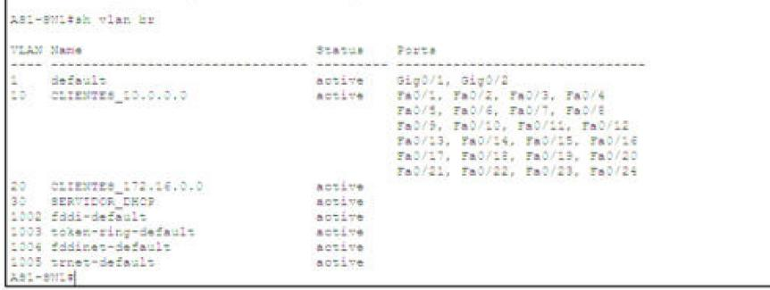

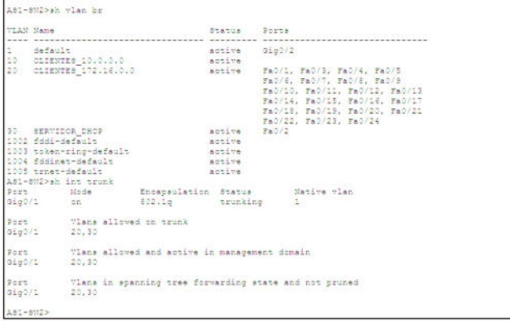


### 5.3 Conectividad interna de cada AS (Req. 2.b)
- `show ip route` en `AS1-R1`: rutas `O` hacia `172.16.0.0/24`, `192.168.1.96/29`, los /30 y las loopbacks, y `O*E2 0.0.0.0/0` originada por `R4` (aprendida por `R2` y por `R3` con igual costo). `show ip ospf neighbor`: `1.1.1.3` y `1.1.1.2` en estado `FULL`.
- `show ip route` en `AS2-R1`: rutas `R` hacia `172.16.0.0/24`, `192.168.2.96/29`, los /30 y las loopbacks, y `R* 0.0.0.0/0` vía `192.168.2.6` (`R2`).
- `show ip ospf neighbor` en `AS99-R6`: `99.99.99.5` y `99.99.99.7` en `FULL`.
- Ping desde `AS1-PC1` y `AS2-PC1` a `172.16.0.1`, a `ASx-PC2` (`172.16.0.10`), a `192.168.x.100` y a las loopbacks de R2, R3 y R4: todos responden. El primer eco hacia `172.16.0.10` se pierde por la resolución ARP inicial (comportamiento normal en Packet Tracer).

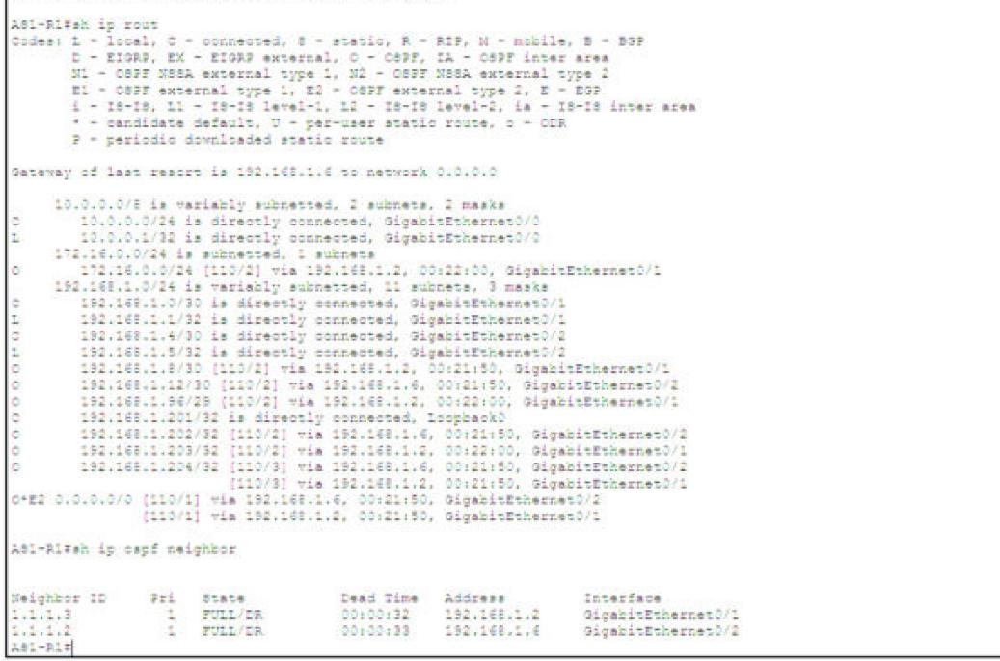

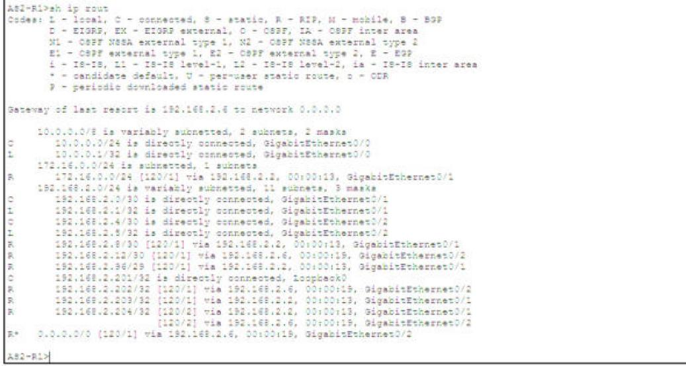

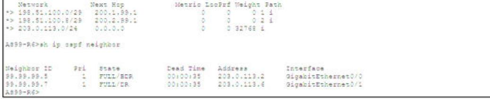

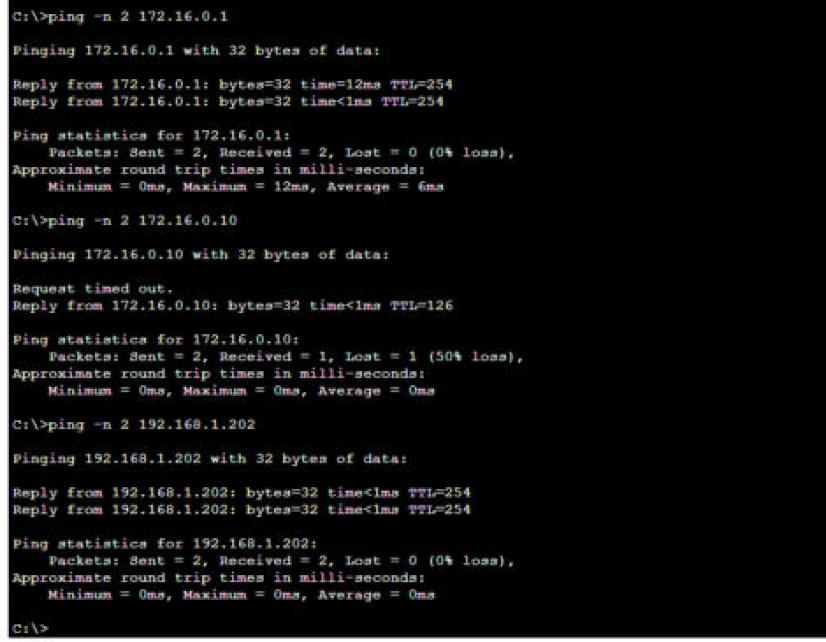

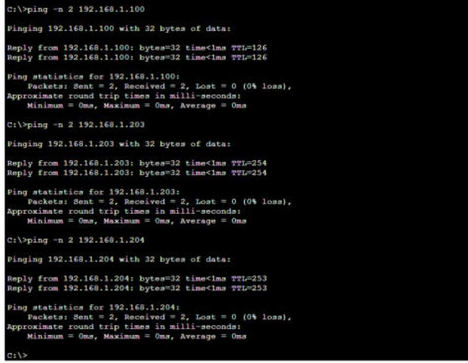

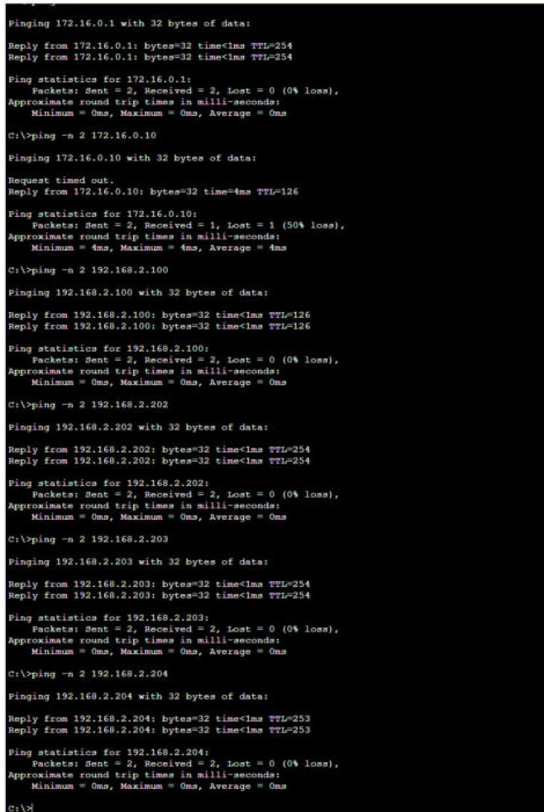

### 5.4 Interconexión entre AS (Req. 3)
- `show ip bgp summary` y `show ip bgp` en `AS99-R6`: las dos sesiones eBGP (`200.1.99.1` AS 1 y `200.2.99.1` AS 2) están establecidas. Tabla obtenida:
  ```text
     Network          Next Hop        Metric LocPrf Weight Path
  *> 198.51.100.0/29  200.1.99.1           0      0      0 1 i
  *> 198.51.100.8/29  200.2.99.1           0      0      0 2 i
  *> 203.0.113.0/24   0.0.0.0              0      0  32768 i
  ```
- `show controllers serial0/0/0` y `serial0/0/1` en `AS99-R6`: ambos `DCE V.35, clock rate 2000000`.
- `show ip bgp` en `AS1-R4`: `203.0.113.0/24` con path `99 i` y `198.51.100.8/29` con path `99 2 i`; en `AS2-R2`, lo simétrico (`198.51.100.0/29` con path `99 1 i`).
- `show ip route` en `AS99-R5`: `O*E2 0.0.0.0/0 [110/1] via 203.0.113.1` (R6).
- **Problema encontrado y corregido:** en la primera corrida, el ping de `AS1-PC1` a `203.0.113.66` fallaba (100 % de pérdida). `show ip nat translations` en `AS1-R4` mostraba la traducción, `show ip bgp` estaba correcto y `AS99-R6` sí alcanzaba al DNS y al WEB; pero `show ip route` en `AS99-R5` decía *Gateway of last resort is not set*, así que la respuesta del DNS hacia `198.51.100.2` no tenía ruta. La causa fue que Packet Tracer rechaza `default-information originate always`. Se agregó `ip route 0.0.0.0 0.0.0.0 Null0` y `default-information originate` en `R6` (archivo `AS99_R6.ios` corregido) y desde entonces todas las pruebas pasan. Además, se volvieron a aplicar todos los `.ios` verificando la salida de cada línea: ninguna otra línea es rechazada por Packet Tracer.
- `show ip nat translations` en `AS1-R4` y `AS2-R2` tras navegar desde los PC (ver 5.6).
- Ping desde `AS1-PC1` a `198.51.100.9` (Loopback1 de `AS2-R2`) y desde `AS2-PC1` a `198.51.100.1` (Loopback1 de `AS1-R4`): responden, lo que confirma el punto 4.4 (solo hay alcance entre los bloques públicos, nunca entre las redes internas).

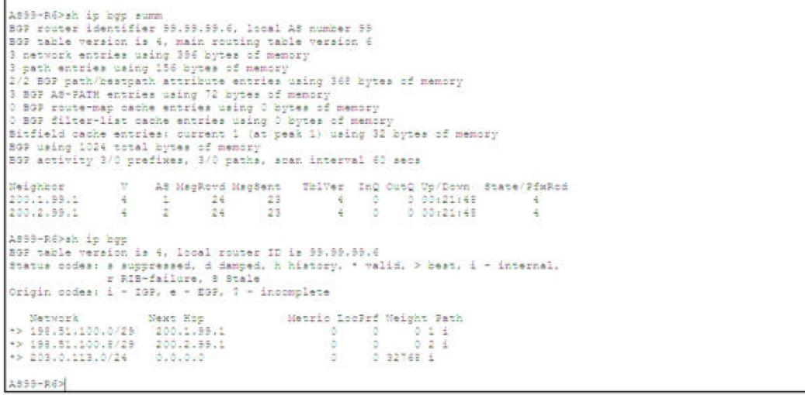

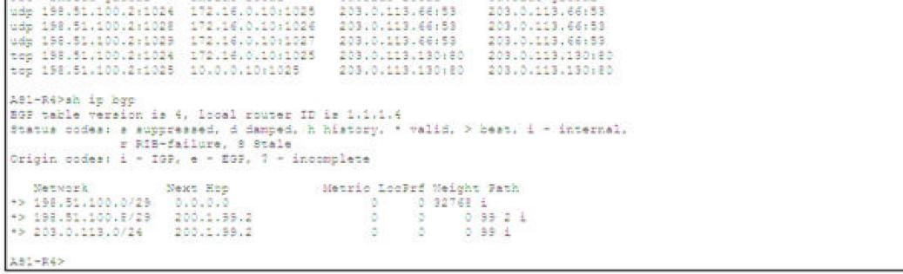

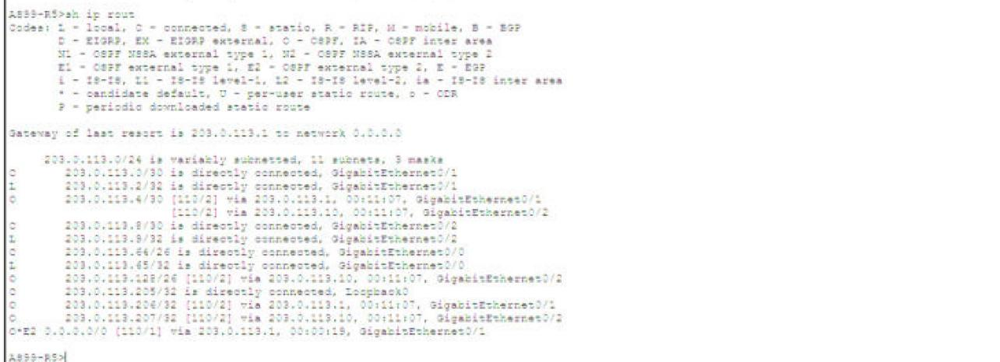

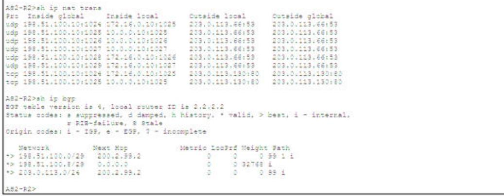


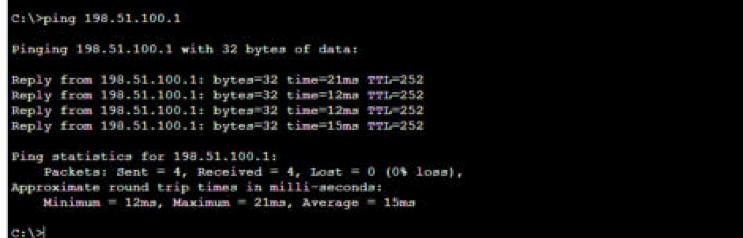

### 5.5 Acceso a servicios (Req. 4 y 6)
Desde **los 4 PC** (todas las pruebas pasaron):
1. `ping 203.0.113.66` y `ping 203.0.113.130` → 4/4 respuestas.
2. `nslookup www.as99.com` → `Server: [203.0.113.66]`, `Address: 203.0.113.130`.
3. `ping www.as99.com` → resuelve a `203.0.113.130` y responde 4/4.
4. *Web Browser* → `http://www.as99.com` → carga la página de `AS99-WEB` (*AS99 - Proveedor de Servicios Centralizados*).

**AS1-PC1**

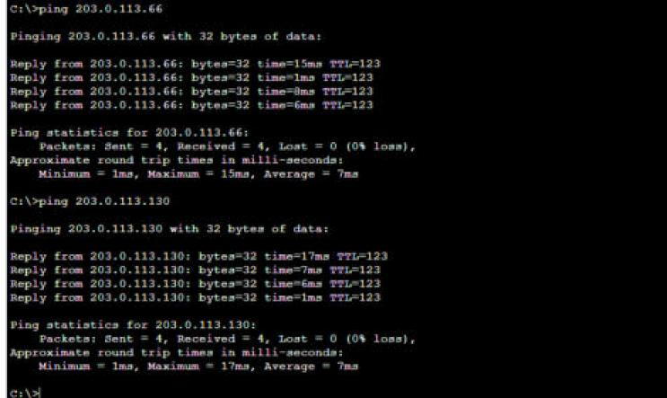

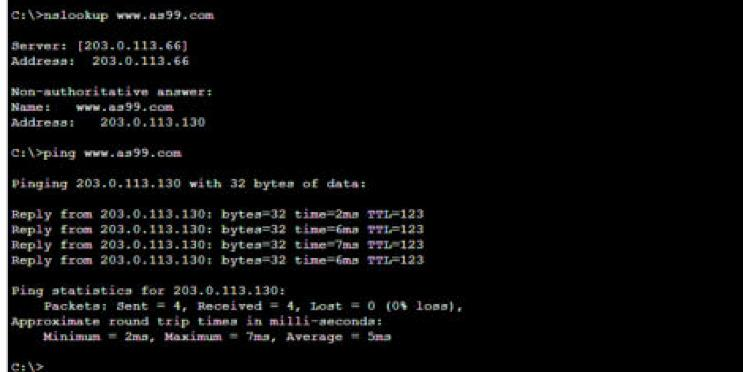


**AS1-PC2**

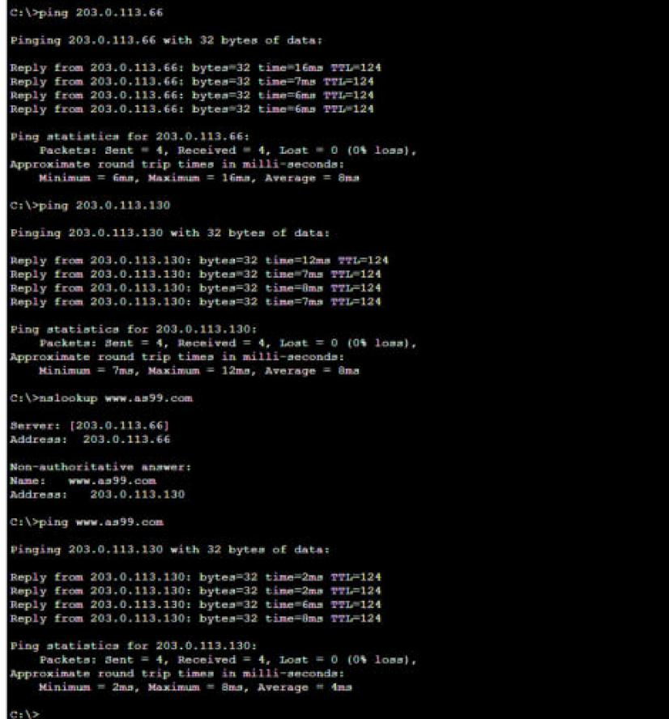


**AS2-PC1**

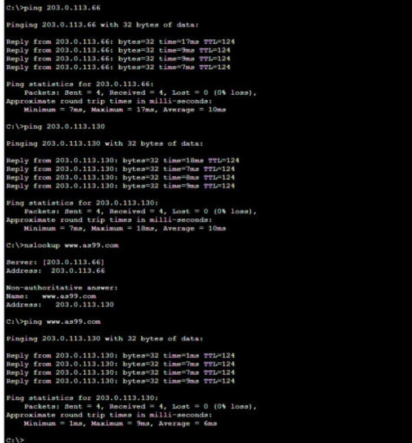


**AS2-PC2**

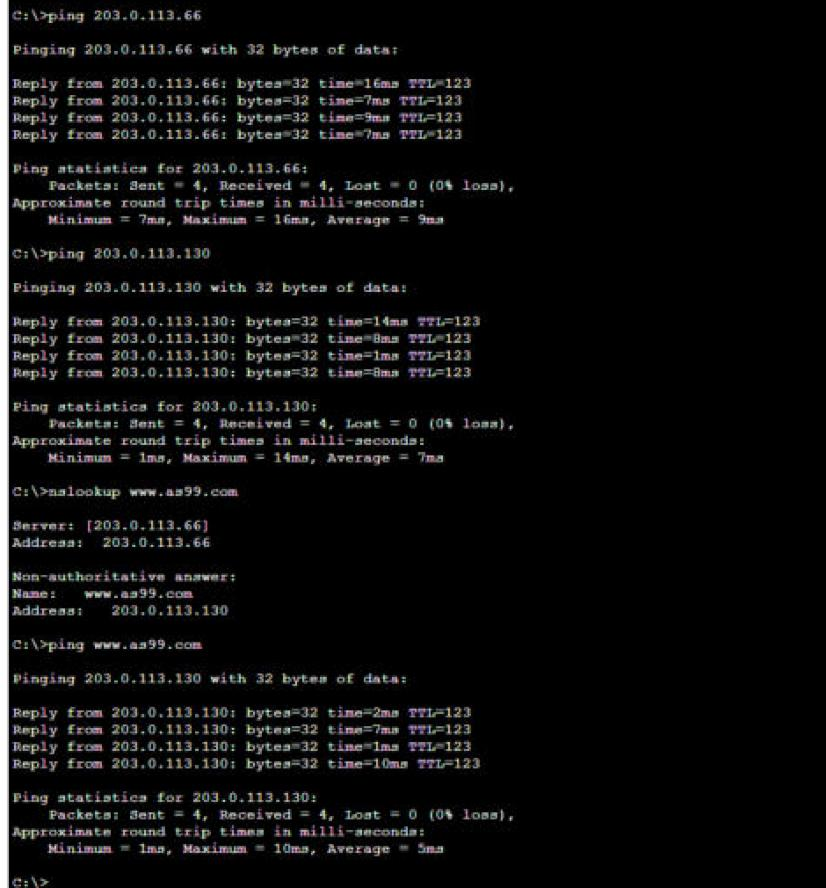

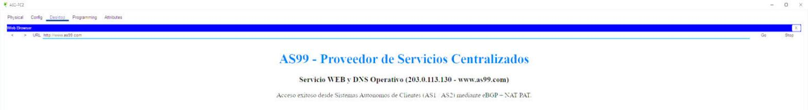

### 5.6 Prueba de solapamiento
`AS1-PC1` y `AS2-PC1` tienen la **misma IP** interna (`10.0.0.10`) y ambos cargaron `http://www.as99.com` (capturas de navegador de 5.5). `show ip nat translations` en los dos bordes muestra la misma dirección y puerto internos con distinta IP global:

| Borde | Inside local | Inside global | Outside |
| :--- | :--- | :--- | :--- |
| `AS1-R4` | `10.0.0.10:1025` | `198.51.100.2:1025` | `203.0.113.130:80` |
| `AS2-R2` | `10.0.0.10:1025` | `198.51.100.10:1025` | `203.0.113.130:80` |

Lo mismo ocurre con `AS1-PC2` y `AS2-PC2` (`172.16.0.10`), traducidos a `198.51.100.2` y `198.51.100.10`, y con las consultas DNS (UDP 53). Las capturas son las de `AS1-R4` y `AS2-R2` en 5.4.

---

## 6. Conclusiones

- La segmentación por VLAN más DHCP Relay permite tener un único servidor DHCP por AS para varias subredes.
- El uso de dos IGP (OSPF y RIP) no afecta la interconexión, porque cada AS es independiente y solo intercambia rutas con el exterior por eBGP.
- El solapamiento de direcciones se resuelve en el borde con PAT y un prefijo público único por cliente, sin tocar el direccionamiento interno.
- La falta de iBGP completo en Packet Tracer se compensa concentrando BGP en `R6` y propagando una ruta por defecto en OSPF dentro de `AS99`.
